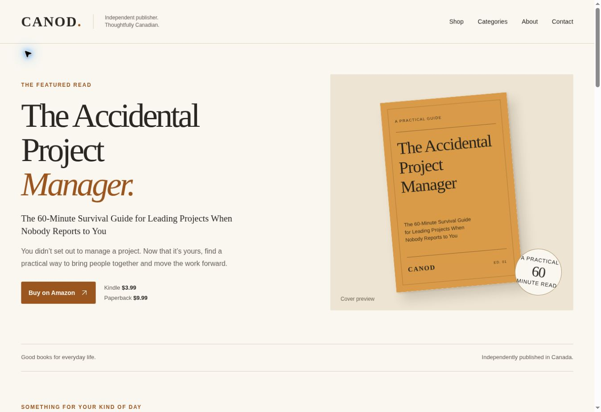

# CANOD bookstore

A warm, mobile-first publisher catalog for **canod.store**. Static HTML, CSS, and a small JavaScript enhancement; no runtime dependencies, shopping cart, checkout, analytics, or cookies. The complete catalog and navigation remain readable with JavaScript off.

Source repository: https://github.com/kamxnet/canod-bookstore



## Site content

- Homepage with the featured Accidental Project Manager, three category cards, all 11 titles, about, newsletter, and contact footer.
- `/word-search/` — 5 titles.
- `/coloring-books/` — 2 titles.
- `/logbooks-journals/` — 3 titles.
- `/practical-guides/` — 1 title.
- `/the-accidental-project-manager/` — focused sales page with paperback and Kindle links.
- Custom 404, sitemap, canonical metadata, and favicon.

Collections use paths on one domain. Separate subdomains are unnecessary for this catalog and are not configured.

## Edit and build

Requires Node.js 20 or newer. There is no package installation step.

```sh
npm run build
npm run check
npm run dev
```

Edit `content/books.json` for titles, descriptions, bylines, display prices, cover paths, and Amazon links. Verify each title's published byline, cover, marketplace and currency before enabling its purchase links. The featured book has been verified; other entries are labelled as the CANOD collection with their listings still being verified.

The generator writes the complete publication to `docs/`. Commit both source and regenerated `docs/` when updating. No browser-side API keys or secrets are required.

## Replace the requested placeholders

1. **Amazon links:** replace each remaining `amazonUrl: "#"` with the title's verified HTTPS Amazon product URL. A missing link displays “Listing being verified” and does not render a purchase button.
2. **Cover images:** put the real JPG, PNG, WebP, or SVG cover in `assets/covers/`, update its `cover` path in `content/books.json`, then build. Portrait 2:3 images work best. Existing images are never overwritten by the generator. Current SVGs are typography-only stand-ins, not approved cover designs.
3. **Contact:** `contactEmail` in `content/site.json` is set to the active CANOD mailbox, `hello@canod.ca`.
4. **Newsletter:** the email field and Subscribe button are disabled until a real provider is configured. No address is saved locally, sent elsewhere, or represented as subscribed. Set `newsletter.action` to your provider's public HTTPS form POST URL, `emailField` to the provider's expected field name, and `hiddenFields` to its non-secret form fields. Add the provider's `privacyUrl`. Confirm the provider's opt-in, consent, unsubscribe, and success/error pages before enabling; no API secret belongs here. The browser then submits directly to that provider, which owns storage and confirmation. Do not use an API-only endpoint.

## Publish to GitHub Pages

This bookstore uses the separate **kamxnet/canod-bookstore** repository. Do not switch the Pages source of `canod-web2`: it currently serves **canod.ca**.

1. Repository created: `kamxnet/canod-bookstore` (public).
2. Website source and ready-to-publish `docs/` files are on its `main` branch.
3. In **Settings → Pages**, set **Deploy from a branch**, branch **main**, folder **/docs**, and save.
4. The existing custom domain is **www.canod.store**. The included `docs/CNAME` preserves it.
5. At the domain's DNS provider, set the apex (`@`) A records to the four GitHub Pages addresses below. Replace conflicting web A/AAAA records only; preserve mail, TXT, and verification records.

| Type | Host | Value |
| --- | --- | --- |
| A | @ | 185.199.108.153 |
| A | @ | 185.199.109.153 |
| A | @ | 185.199.110.153 |
| A | @ | 185.199.111.153 |
| CNAME | www | kamxnet.github.io |

6. Once DNS validates and the certificate is issued, enable **Enforce HTTPS**. Verify the home page and all four collection pages on the domain.

GitHub reference: https://docs.github.com/en/pages/configuring-a-custom-domain-for-your-github-pages-site/managing-a-custom-domain-for-your-github-pages-site

The live configuration targets `https://www.canod.store`. Preserve the existing DNS and Pages configuration when updating site content.

## Status

The existing bookstore is live on its custom domain. Verify deployment after every update. Newsletter delivery is unconfigured. The featured book is ready for purchase through Amazon; the remaining titles require individual listing verification.

## First-sale campaign: October 26, 2026

The featured book now uses its published byline, cover, verified Amazon.com paperback and Kindle destinations, and a dedicated `/the-accidental-project-manager/` sales page. US prices are dated and explicitly labelled. The contact mailbox is `hello@canod.ca`. Other catalog entries remain unpublished purchase paths until their individual listings are checked; their former placeholder Buy buttons and unverified prices have been removed.

Canonical site: https://www.canod.store/ (the existing domain redirects there). No customer checkout, mailing-list collection, ad spend or new subscription is introduced. Amazon remains the checkout, fulfilment and returns provider. Keep this section and the content files current when additional listings are verified.
